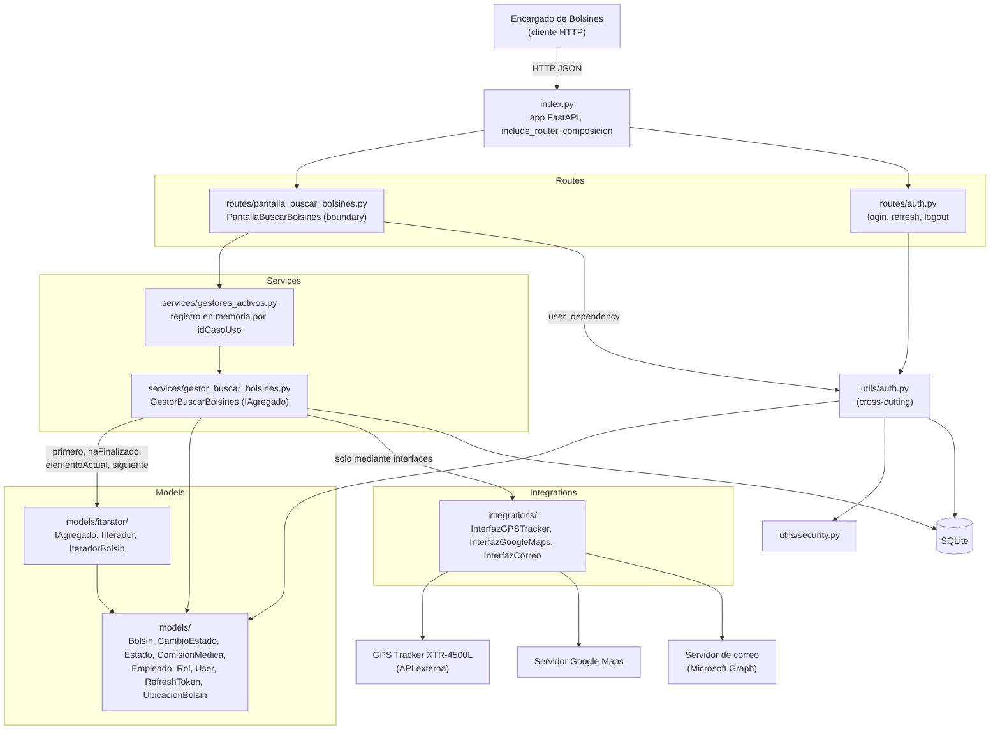

# 01 - Arquitectura del backend (CU 36)

Todo el repositorio es el backend. No hay carpeta `backend/`: `index.py`, `config/`, `models/`, `services/`, `routes/`, `schemas/`, `utils/`, `integrations/`, `data/` y `tests/` viven en la raiz. La raiz es tambien la raiz de imports (`from models import ...`).

## 1. Diagrama de capas



Puntos clave:

- **`routes/pantalla_buscar_bolsines.py` = PantallaBuscarBolsines (boundary).** Cada endpoint corresponde a un metodo de la pantalla del diagrama de secuencia de la Entrega 1 (`opcionSeguirBolsines`, `mostrarCM`, `mostrarMapaBolsines`, `pedirFormaSeleccionBolsin`, `tomarSeleccionBolsin`, `pedirConfirmacionEnvioCorreo`, `tomarConfirmacionEnvioCorreo`). Solo traduce HTTP a llamadas del gestor y del gestor a schemas. No tiene logica de negocio, no accede a la base ni a integraciones.
- **`services/` = GestorBuscarBolsines.** Coordina el CU, es el agregado del Iterator (`IAgregado.crearIterador`) y es el unico que recorre bolsines, siempre con `primero`, `haFinalizado`, `elementoActual` y `siguiente`.
- **`models/` = entidades con metodos de negocio + Iterator.** Las reglas (`esTuCMOrigen`, `sosEnviado`, `comprobarFiltro`) no dependen de HTTP, de integraciones ni de la configuracion.
- **`integrations/` = adaptadores.** El gestor solo ve interfaces. Las implementaciones reales y los fakes viven detras de ellas.
- **`utils/` = cross-cutting.** Autenticacion y seguridad. Sin logica de negocio del CU 36.

## 2. Clase del diseno -> carpeta/archivo

| Clase del diseno | Archivo | Notas |
|---|---|---|
| `GestorBuscarBolsines` | `services/gestor_buscar_bolsines.py` | Implementa `IAgregado`. Atributos: `seleccionBolsin`, `bolsines`, `ubicaciones`. |
| `IAgregado` | `models/iterator/i_agregado.py` | Interfaz (ABC). Declara `crearIterador`. |
| `IIterador` | `models/iterator/i_iterador.py` | Interfaz (ABC). `primero`, `siguiente`, `haFinalizado`, `elementoActual`, `comprobarFiltro`. |
| `IteradorBolsin` | `models/iterator/iterador_bolsin.py` | Concreto. Recibe `elementos` y `filtros` en `new`. |
| `Bolsin` | `models/bolsin.py` | Entidad SQLModel. Atributos: `numeroBolsin`, `fecha`, `numeroPrecinto`, `peso`. Metodos: `esTuCMOrigen`, `sosEnviado`, `getNumeroBolsin`. |
| `CambioEstado` | `models/cambio_estado.py` | Entidad SQLModel. `fechaHoraInicio`, `fechaHoraFin`, `sosActual`, `sosEnviado`. Nombre segun Entrega 2. |
| `Estado` | `models/estado.py` | Entidad SQLModel. `nombre`, `descripcion`, `esEnviado`. |
| `ComisionMedica` | `models/comision_medica.py` | Entidad SQLModel. `codigo`, `getCodigo`. |
| `Empleado` | `models/empleado.py` | Entidad SQLModel. `esTuCM`, `sosGCM`. Relacion 1 a 1 con `User` (`idUser` unico). Es el usuario de negocio logueado en el CU. |
| `Rol` | `models/rol.py` | Entidad SQLModel. `esGCM`. |
| `User` | `models/user.py` | Entidad de login (snake_case segun referencia). `id`, `mail`, `hashed_password` (o equivalente), `verify_password`. |
| `RefreshToken` | `models/refresh_token.py` | Entidad de sesion de auth. `id_user`, `token_hash`, `expires_at`. No es `Sesion` de los diagramas. |
| `UbicacionBolsin` | `models/ubicacion_bolsin.py` | Value object: `numeroBolsin`, `latitud`, `longitud`, `fechaHoraUltimaActualizacion`. Lo produce la integracion GPS. |
| `InterfazGPSTracker` | `integrations/gps_tracker/interfaz_gps_tracker.py` | Interfaz con `getBolsinLocation(numeroBolsin, codigoCM)`. |
| (impl. GPS) | `integrations/gps_tracker/gps_tracker_xtr4500l.py` | Llamada HTTP real. Pendiente de URL y API key. |
| (fake GPS) | `integrations/gps_tracker/gps_tracker_fake.py` | Para tests. |
| `InterfazGoogleMaps` | `integrations/google_maps/interfaz_google_maps.py` | Interfaz con `obtenerMapa`. Alcance pendiente. |
| (impl. Maps) | `integrations/google_maps/google_maps_adapter.py` | Pendiente. |
| `InterfazCorreo` | `integrations/correo/interfaz_correo.py` | Interfaz con `enviarMail(destinatario, asunto, cuerpo)`. Nombre aprobado. |
| (impl. correo) | `integrations/correo/outlook_graph.py` | Microsoft Graph. Pendiente de credenciales. |
| (fake correo) | `integrations/correo/correo_fake.py` | Para tests. |
| Gestores en memoria | `services/gestores_activos.py` | Seccion 4. No es clase del diagrama. |
| Schemas CU 36 | `schemas/seguimiento.py` | Pydantic. Sin logica. |
| Schemas auth | `schemas/auth.py` | Pydantic: login y token. |
| Endpoints CU 36 | `routes/pantalla_buscar_bolsines.py` | Boundary. |
| Endpoints auth | `routes/auth.py` | Login, refresh, logout. |
| Autenticacion | `utils/auth.py` | Cookies de refresh, `authenticate_user`, `issue_tokens`, `get_current_user`, `user_dependency`. |
| Seguridad | `utils/security.py` | JWT (`create_access_token`, `decode_access_token`), `generate_refresh_token`, `hash_token`. |
| Configuracion | `config/settings.py`, `config/database.py` | Variables de entorno y engine SQLite async. |
| Composicion | `config/composicion.py` | Arma el gestor con implementaciones reales o fakes. |
| Entrypoint | `index.py` | Crea la app, incluye routers, usa composicion. |

## 3. Justificacion de ubicacion

- **Entidades e Iterator en `models/`.** Las reglas del dominio deben poder probarse sin FastAPI, sin red y sin base. AGENTS.md prohibe los modelos anemicos.
- **Gestor en `services/`.** Coordina el caso de uso, que no es una regla de una sola entidad. Es el agregado del patron Iterator.
- **Routes en `routes/`.** Es la pantalla del diagrama. Solo traduce HTTP.
- **Schemas en `schemas/`.** Solo validan y serializan. El contrato HTTP queda separado de las entidades.
- **`integrations/` no es `models/`.** Una entidad no debe conocer credenciales, URLs, timeouts ni formatos de respuesta de un GPS. Si esa logica estuviera en `models/`, los tests de dominio necesitarian red, y cambiar de proveedor obligaria a tocar entidades.
- **`integrations/` no es `utils/`.** `utils/` es para codigo transversal que no pertenece al dominio ni a un proveedor externo: auth y seguridad. Mezclar integraciones ahi haria que cada proveedor quedara sin dueno claro. Cada integracion tiene su carpeta y su interfaz.
- **Interfaces en `integrations/`, no en `services/`.** El gestor depende de la abstraccion y la implementacion queda aislada. Asi se cumple la regla de tener una implementacion real y una fake.
- **`utils/auth.py` no tiene reglas del CU 36.** Es autenticacion (requisito no funcional 4 de la ERS). Vive en `utils/` y no en `services/` porque no coordina el caso de uso.

## 4. Manejo del estado del caso de uso

**Problema:** el gestor guarda estado (`seleccionBolsin`, `bolsines`, `ubicaciones`) entre pasos del CU, pero HTTP es stateless. Cada request crea un proceso nuevo.

**Solucion propuesta:** un diccionario en memoria en `services/gestores_activos.py`, indexado por `idCasoUso` (UUID4). Cada gestor vive mientras dura su caso de uso.

Flujo de endpoints (rutas orientativas, se definen al implementar):

1. `POST /seguimiento-bolsines` (opcionSeguirBolsines). Crea el gestor, ejecuta `buscarUsuarioLogueado`, `getCMUsuarioLogueado`, `obtenerCodigoBolsinesEnviados`, consulta el GPS y devuelve `idCasoUso`, la CM y las ubicaciones.
2. `POST /seguimiento-bolsines/{idCasoUso}/seleccion` (tomarSeleccionBolsin). Guarda `seleccionBolsin`.
3. `POST /seguimiento-bolsines/{idCasoUso}/confirmacion-correo` (tomarConfirmacionEnvioCorreo). Ejecuta `enviarMailGCM` y finaliza el caso de uso.
4. `DELETE /seguimiento-bolsines/{idCasoUso}` (A4, cancelar). Elimina el gestor del diccionario.

**Reglas de implementacion:**
- El gestor guarda **datos planos** (numero de bolsin, precinto, codigo de CM destino, `UbicacionBolsin`), no instancias de SQLModel ligadas a una sesion. Asi no hay errores de sesion cerrada entre requests.
- Cada gestor tiene un `tiempoExpiracion` (por ejemplo, 15 minutos). Al acceder se eliminan los vencidos.
- Un `idCasoUso` inexistente o vencido devuelve 404 desde `routes`.

**Limitaciones (documentar en el informe):**
- **Un solo proceso.** Con varios workers de uvicorn o gunicorn, cada worker tiene su propio diccionario y el `idCasoUso` no siempre se encuentra. Hay que ejecutar un unico worker.
- **No persiste.** Un reinicio pierde los casos de uso en curso. Es aceptable porque el CU es corto.
- **Memoria sin tope.** Si no se limpia, crece con cada caso abandonado. El TTL lo mitiga pero no lo elimina.
- **No escala horizontalmente.** Para escalar haria falta guardar el estado en Redis o en la base. Fuera del alcance del TP.
- **Concurrencia.** El diccionario se accede desde varios requests a la vez: alta y baja protegidas con `threading.Lock`.
- **Tests.** Hay que resetear el diccionario entre tests (fixture en `tests/conftest.py`).

## 5. Regla de dependencias

Principio: las dependencias apuntan hacia adentro. Nada del nucleo conoce a la capa que lo usa.

| Desde \ hacia | config | models | models/iterator | services | integrations | utils | routes | schemas |
|---|---|---|---|---|---|---|---|---|
| **index.py** | si | no | no | si (solo composicion) | no | no | si | no |
| **routes** | no | no | no | no | no | si (solo `user_dependency`) | - | si |
| **schemas** | no | no | no | no | no | no | no | - |
| **services** | si (`database`, `settings`) | si | si | - | si (solo interfaces) | no | no | no |
| **models** | no | si (entre si) | si | no | no | no | no | no |
| **models/iterator** | no | si | - | no | no | no | no | no |
| **integrations** | si (solo `settings`) | si (solo value objects) | no | no | - | no | no | no |
| **utils** | si (`settings`, `database`) | si (`User`, `RefreshToken`) | no | no | no | - | no | no |
| **config/composicion.py** | si | si | si | si | si | no | no | no |
| **tests** | si | si | si | si | si | si | si | si |

Reglas concretas:

1. `models` nunca importa `services`, `routes`, `integrations`, `utils`, `schemas` ni `config`. Las entidades solo conocen SQLModel.
2. `models/iterator` solo importa de `models`. Nunca de `services`.
3. `services` llama a `integrations` solo a traves de las interfaces (`InterfazGPSTracker`, `InterfazCorreo`, etc.), nunca a las implementaciones concretas.
4. `integrations` no importa `services`, `routes` ni `utils`. Puede importar `models` solo para value objects (ej. `UbicacionBolsin`) y `config.settings`.
5. `routes` no importa `models`, `integrations` ni `config`. Recibe objetos del gestor y los convierte en schemas. Puede importar `utils/auth.py` solo para `user_dependency` y para las funciones del login.
6. `schemas` no importa nada del proyecto.
7. `utils/auth.py` puede importar `config`, `models` (`User`, `RefreshToken`) y `utils/security.py`. Ningun modulo de negocio (`services`, `models`) importa `utils`.
8. `config/composicion.py` es el unico modulo que importa `services` e `integrations` juntos. Solo lo importa `index.py`.
9. `index.py` es el unico punto que une `routes`, `config`, `utils` y la composicion.
10. Relaciones SQLModel (`Bolsin` <-> `CambioEstado` <-> `Estado`, `Empleado` <-> `User`, `Empleado` -> `ComisionMedica`): se declaran con nombres en string. `models/__init__.py` importa todas las clases en un orden fijo. Nunca se importan clases entre si a nivel de modulo en ambos sentidos.
11. Si aparece un ciclo en revision, se corrige moviendo la dependencia a `config/composicion.py` o a un tipo auxiliar. No se usan imports tardios para tapar ciclos.

## 6. Relacion User / Empleado (1 a 1)

- `User` es la entidad de login: `id`, `mail` (unico), contrasena hasheada. Los metodos de verificacion de contrasena viven en la entidad.
- `Empleado` es el dato de negocio: `esTuCM`, `sosGCM`, con `Rol` y `ComisionMedica`. Tiene `idUser` unico que referencia a `User.id`.
- `Empleado.email` del dominio no se duplica: el correo es `User.mail`.
- Esta relacion es 1 a 1: cada `User` corresponde a como mucho un `Empleado`, y cada `Empleado` a un unico `User`.

## 7. Arbol de archivos propuesto

```
index.py                               # entrypoint FastAPI: app, include_router, composicion
requirements.txt                       # dependencias (aprobadas, sin versiones fijas todavia)
config/
  __init__.py
  settings.py                          # DB_URL, REFRESH_DAYS, COOKIE_SECURE, COOKIE_SAMESITE, GPS_*, CORREO_*
  database.py                          # engine SQLite async, create_all, db_dependency
  composicion.py                       # composition root: gestor con implementaciones reales o fakes
models/
  __init__.py                          # importa las entidades en orden fijo
  estado.py                            # Estado
  cambio_estado.py                     # CambioEstado
  bolsin.py                            # Bolsin (numeroBolsin, fecha, numeroPrecinto, peso)
  comision_medica.py                   # ComisionMedica
  rol.py                               # Rol
  empleado.py                          # Empleado (esTuCM, sosGCM, idUser 1 a 1)
  user.py                              # User (mail, contrasena hasheada, verify_password)
  refresh_token.py                     # RefreshToken
  ubicacion_bolsin.py                  # UbicacionBolsin (value object)
  iterator/
    __init__.py
    i_agregado.py                      # IAgregado
    i_iterador.py                      # IIterador
    iterador_bolsin.py                 # IteradorBolsin
data/
  bolsines.db                          # base SQLite
  seed.py                              # datos semilla: comisiones, roles, empleados, usuarios, bolsines
routes/
  __init__.py
  pantalla_buscar_bolsines.py          # APIRouter: PantallaBuscarBolsines (boundary, CU 36)
  auth.py                              # login, refresh, logout
schemas/
  __init__.py
  seguimiento.py                       # request/response CU 36
  auth.py                              # login y token
services/
  __init__.py
  gestor_buscar_bolsines.py            # GestorBuscarBolsines (IAgregado)
  gestores_activos.py                  # registro en memoria por idCasoUso (TTL + Lock)
utils/
  __init__.py
  auth.py                              # cookies, authenticate_user, issue_tokens, get_current_user, user_dependency
  security.py                          # JWT, refresh token, hash
integrations/
  __init__.py
  gps_tracker/
    __init__.py
    interfaz_gps_tracker.py            # InterfazGPSTracker
    gps_tracker_xtr4500l.py            # implementacion real (pendiente de URL y API key)
    gps_tracker_fake.py                # fake para tests
  google_maps/
    __init__.py
    interfaz_google_maps.py            # InterfazGoogleMaps
    google_maps_adapter.py             # pendiente
  correo/
    __init__.py
    interfaz_correo.py                 # InterfazCorreo
    outlook_graph.py                   # pendiente de credenciales
    correo_fake.py                     # fake para tests
tests/
  __init__.py
  conftest.py                          # base en memoria, reset de gestores_activos
  test_bolsin.py                       # esTuCMOrigen, sosEnviado
  test_iterador_bolsin.py              # primero, siguiente, haFinalizado, comprobarFiltro
  test_gestor_buscar_bolsines.py       # flujo principal y A1, A2, A4, A5
  test_gps_tracker_xtr4500l.py         # parseo de getBolsinLocation (A3)
  test_routes_seguimiento.py           # endpoints HTTP con fakes
  test_auth.py                         # login, refresh, logout, user_dependency
docs/
  00-contexto.md
  01-arquitectura.md
  99-decisiones-y-dudas.md
  referencias/                         # documentos fuente (solo lectura)
```

Notas:
- Nombres de archivo en `snake_case`. Nombres de clases y metodos segun los diagramas (AGENTS.md §5).
- Los archivos marcados como pendientes no se crean hasta tener la informacion necesaria (GPS, correo, Google Maps).
- `google_maps_adapter.py` y `outlook_graph.py` pueden quedar sin implementacion real en esta entrega.
