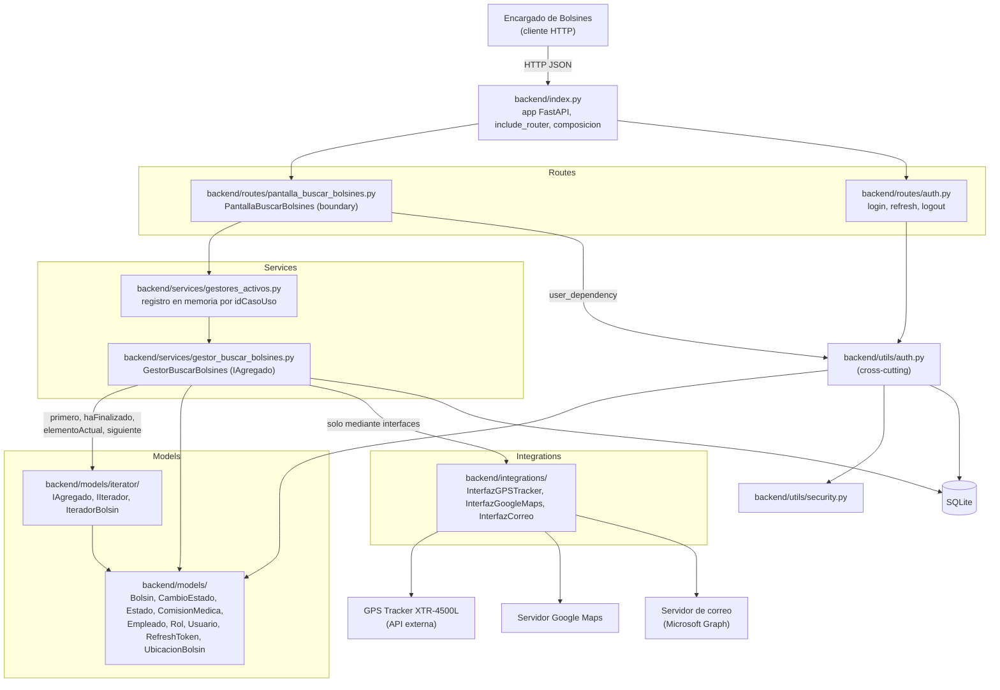

# 01 - Arquitectura del backend (CU 36)

El repositorio es un monorepo: el backend vive en `backend/` y el frontend en `frontend/`. `docs/` queda en la raiz. El backend se ejecuta desde la raiz con `uvicorn index:app --app-dir backend --port 8020`, y los imports son relativos a `backend/` (`from models import ...`).

## 1. Diagrama de capas



Puntos clave:

- **`backend/routes/pantalla_buscar_bolsines.py` = PantallaBuscarBolsines (boundary).** Cada endpoint corresponde a un metodo de la pantalla del diagrama de secuencia de la Entrega 1 (`opcionSeguirBolsines`, `mostrarCM`, `mostrarMapaBolsines`, `pedirFormaSeleccionBolsin`, `tomarSeleccionBolsin`, `pedirConfirmacionEnvioCorreo`, `tomarConfirmacionEnvioCorreo`). Solo traduce HTTP a llamadas del gestor y del gestor a schemas. No tiene logica de negocio, no accede a la base ni a integraciones.
- **`backend/services/` = GestorBuscarBolsines.** Coordina el CU, es el agregado del Iterator (`IAgregado.crearIterador`) y es el unico que recorre bolsines, siempre con `primero`, `haFinalizado`, `elementoActual` y `siguiente`.
- **`backend/models/` = entidades con metodos de negocio + Iterator.** Las reglas (`esTuCMOrigen`, `sosEnviado`, `comprobarFiltro`) no dependen de HTTP, de integraciones ni de la configuracion.
- **`backend/integrations/` = adaptadores.** El gestor solo ve interfaces. Las implementaciones reales y los fakes viven detras de ellas.
- **`backend/utils/` = cross-cutting.** Autenticacion y seguridad. Sin logica de negocio del CU 36.

## 2. Clase del diseno -> carpeta/archivo

| Clase del diseno | Archivo | Notas |
|---|---|---|
| `GestorBuscarBolsines` | `backend/services/gestor_buscar_bolsines.py` | Implementa `IAgregado`. Atributos: `seleccionBolsin`, `bolsines`, `ubicaciones`. |
| `IAgregado` | `backend/models/iterator/i_agregado.py` | Interfaz (ABC). Declara `crearIterador`. |
| `IIterador` | `backend/models/iterator/i_iterador.py` | Interfaz (ABC). `primero`, `siguiente`, `haFinalizado`, `elementoActual`, `comprobarFiltro`. |
| `IteradorBolsin` | `backend/models/iterator/iterador_bolsin.py` | Concreto. Recibe `elementos` y `filtros` en `new`. |
| `Bolsin` | `backend/models/bolsin.py` | Entidad SQLModel. Atributos: `numeroBolsin`, `fecha`, `numeroPrecinto`, `peso`. Metodos: `esTuCMOrigen`, `sosEnviado`, `getNumeroBolsin`. |
| `CambioEstado` | `backend/models/cambio_estado.py` | Entidad SQLModel. `fechaHoraInicio`, `fechaHoraFin`, `sosActual`, `sosEnviado`. Nombre segun Entrega 2. |
| `Estado` | `backend/models/estado.py` | Entidad SQLModel. `nombre`, `descripcion`, `esEnviado`. |
| `ComisionMedica` | `backend/models/comision_medica.py` | Entidad SQLModel. `codigo`, `getCodigo`. |
| `Empleado` | `backend/models/empleado.py` | Entidad SQLModel. `esTuCM`, `sosGCM`. Relacion 1 a 1 con `Usuario` (`idUser` unico). Es el usuario de negocio logueado en el CU. |
| `Rol` | `backend/models/rol.py` | Entidad SQLModel. `esGCM`. |
| `Usuario` | `backend/models/usuario.py` | Entidad de login. `id`, `mail`, `hashedPassword`, `verify_password`. (Antes se llamaba `User`, ver bitacora.) |
| `RefreshToken` | `backend/models/refresh_token.py` | Entidad de sesion de auth. `idUser`, `tokenHash`, `expiresAt`. No es `Sesion` de los diagramas. Detalle en `docs/02-modelo-datos.md`. |
| `UbicacionBolsin` | `backend/models/ubicacion_bolsin.py` | Value object: `numeroBolsin`, `latitud`, `longitud`, `fechaHoraUltimaActualizacion`. Lo produce la integracion GPS. |
| `InterfazGPSTracker` | `backend/integrations/gps_tracker/interfaz_gps_tracker.py` | Interfaz con `getBolsinLocation(numeroBolsin, codigoCM)`. |
| (impl. GPS) | `backend/integrations/gps_tracker/gps_tracker_xtr4500l.py` | Llamada HTTP real. Pendiente de URL y API key. |
| (fake GPS) | `backend/integrations/gps_tracker/gps_tracker_fake.py` | Para tests. |
| `InterfazGoogleMaps` | `backend/integrations/google_maps/interfaz_google_maps.py` | Interfaz con `obtenerMapa`. Alcance pendiente. |
| (impl. Maps) | `backend/integrations/google_maps/google_maps_adapter.py` | Pendiente. |
| `InterfazCorreo` | `backend/integrations/correo/interfaz_correo.py` | Interfaz con `enviarMail(destinatario, asunto, cuerpo)`. Nombre aprobado. |
| (impl. correo) | `backend/integrations/correo/outlook_graph.py` | Microsoft Graph. Pendiente de credenciales. |
| (fake correo) | `backend/integrations/correo/correo_fake.py` | Para tests. |
| Gestores en memoria | `backend/services/gestores_activos.py` | Seccion 4. No es clase del diagrama. |
| Schemas CU 36 | `backend/schemas/seguimiento.py` | Pydantic. Sin logica. |
| Schemas auth | `backend/schemas/auth.py` | Pydantic: login y token. |
| Endpoints CU 36 | `backend/routes/pantalla_buscar_bolsines.py` | Boundary. |
| Endpoints auth | `backend/routes/auth.py` | Login, refresh, logout. |
| Autenticacion | `backend/utils/auth.py` | Cookies de refresh, `authenticate_user`, `issue_tokens`, `get_current_user`, `user_dependency`. |
| Seguridad | `backend/utils/security.py` | JWT (`create_access_token`, `decode_access_token`), `generate_refresh_token`, `hash_token`. |
| Configuracion | `backend/config/settings.py`, `backend/config/database.py` | Variables de entorno y engine SQLite async. |
| Composicion | `backend/config/composicion.py` | Arma el gestor con implementaciones reales o fakes. |
| Entrypoint | `backend/index.py` | Crea la app, incluye routers, usa composicion. |

## 3. Justificacion de ubicacion

- **Entidades e Iterator en `backend/models/`.** Las reglas del dominio deben poder probarse sin FastAPI, sin red y sin base. AGENTS.md prohibe los modelos anemicos.
- **Gestor en `backend/services/`.** Coordina el caso de uso, que no es una regla de una sola entidad. Es el agregado del patron Iterator.
- **Routes en `backend/routes/`.** Es la pantalla del diagrama. Solo traduce HTTP.
- **Schemas en `backend/schemas/`.** Solo validan y serializan. El contrato HTTP queda separado de las entidades.
- **`backend/integrations/` no es `backend/models/`.** Una entidad no debe conocer credenciales, URLs, timeouts ni formatos de respuesta de un GPS. Si esa logica estuviera en `backend/models/`, los tests de dominio necesitarian red, y cambiar de proveedor obligaria a tocar entidades.
- **`backend/integrations/` no es `backend/utils/`.** `backend/utils/` es para codigo transversal que no pertenece al dominio ni a un proveedor externo: auth y seguridad. Mezclar integraciones ahi haria que cada proveedor quedara sin dueno claro. Cada integracion tiene su carpeta y su interfaz.
- **Interfaces en `backend/integrations/`, no en `backend/services/`.** El gestor depende de la abstraccion y la implementacion queda aislada. Asi se cumple la regla de tener una implementacion real y una fake.
- **`backend/utils/auth.py` no tiene reglas del CU 36.** Es autenticacion (requisito no funcional 4 de la ERS). Vive en `backend/utils/` y no en `backend/services/` porque no coordina el caso de uso.

## 4. Manejo del estado del caso de uso

**Problema:** el gestor guarda estado (`seleccionBolsin`, `bolsines`, `ubicaciones`) entre pasos del CU, pero HTTP es stateless. Cada request crea un proceso nuevo.

**Solucion propuesta:** un diccionario en memoria en `backend/services/gestores_activos.py`, indexado por `idCasoUso` (UUID4). Cada gestor vive mientras dura su caso de uso.

Flujo de endpoints (rutas orientativas, se definen al implementar):

1. `POST /seguimiento-bolsines` (opcionSeguirBolsines). Crea el gestor, ejecuta `buscarUsuarioLogueado`, `getCMUsuarioLogueado`, `obtenerCodigoBolsinesEnviados`, consulta el GPS y devuelve `idCasoUso`, la CM y las ubicaciones.
2. `POST /seguimiento-bolsines/{idCasoUso}/seleccion` (tomarSeleccionBolsin). Guarda `seleccionBolsin`.
3. `POST /seguimiento-bolsines/{idCasoUso}/confirmacion-correo` (tomarConfirmacionEnvioCorreo). Ejecuta `enviarMailGCM` y finaliza el caso de uso.
4. `DELETE /seguimiento-bolsines/{idCasoUso}` (A4, cancelar). Elimina el gestor del diccionario.

**Reglas de implementacion:**
- El gestor guarda **datos planos** (numero de bolsin, precinto, codigo de CM destino, `UbicacionBolsin`), no instancias de SQLModel ligadas a una sesion. Asi no hay errores de sesion cerrada entre requests.
- Cada gestor tiene un `tiempoExpiracion` (por ejemplo, 15 minutos). Al acceder se eliminan los vencidos.
- Un `idCasoUso` inexistente o vencido devuelve 404 desde `routes`.

**Limitaciones (documentar en el informe):**
- **Un solo proceso.** Con varios workers de uvicorn o gunicorn, cada worker tiene su propio diccionario y el `idCasoUso` no siempre se encuentra. Hay que ejecutar un unico worker.
- **No persiste.** Un reinicio pierde los casos de uso en curso. Es aceptable porque el CU es corto.
- **Memoria sin tope.** Si no se limpia, crece con cada caso abandonado. El TTL lo mitiga pero no lo elimina.
- **No escala horizontalmente.** Para escalar haria falta guardar el estado en Redis o en la base. Fuera del alcance del TP.
- **Concurrencia.** El diccionario se accede desde varios requests a la vez: alta y baja protegidas con `threading.Lock`.
- **Tests.** Hay que resetear el diccionario entre tests (fixture en `backend/tests/conftest.py`).

## 5. Regla de dependencias

Principio: las dependencias apuntan hacia adentro. Nada del nucleo conoce a la capa que lo usa.

| Desde \ hacia | config | models | backend/models/iterator | services | integrations | utils | routes | schemas |
|---|---|---|---|---|---|---|---|---|
| **backend/index.py** | si | no | no | si (solo composicion) | no | no | si | no |
| **routes** | no | no | no | no | no | si (solo `user_dependency`) | - | si |
| **schemas** | no | no | no | no | no | no | no | - |
| **services** | si (`database`, `settings`) | si | si | - | si (solo interfaces) | no | no | no |
| **models** | no | si (entre si) | si | no | no | no | no | no |
| **backend/models/iterator** | no | si | - | no | no | no | no | no |
| **integrations** | si (solo `settings`) | si (solo value objects) | no | no | - | no | no | no |
| **utils** | si (`settings`, `database`) | si (`Usuario`, `RefreshToken`) | no | no | no | - | no | no |
| **backend/config/composicion.py** | si | si | si | si | si | no | no | no |
| **tests** | si | si | si | si | si | si | si | si |

Reglas concretas:

1. `models` nunca importa `services`, `routes`, `integrations`, `utils`, `schemas` ni `config`. Las entidades solo conocen SQLModel.
2. `backend/models/iterator` solo importa de `models`. Nunca de `services`.
3. `services` llama a `integrations` solo a traves de las interfaces (`InterfazGPSTracker`, `InterfazCorreo`, etc.), nunca a las implementaciones concretas.
4. `integrations` no importa `services`, `routes` ni `utils`. Puede importar `models` solo para value objects (ej. `UbicacionBolsin`) y `config.settings`.
5. `routes` no importa `models`, `integrations` ni `config`. Recibe objetos del gestor y los convierte en schemas. Puede importar `backend/utils/auth.py` solo para `user_dependency` y para las funciones del login.
6. `schemas` no importa nada del proyecto.
7. `backend/utils/auth.py` puede importar `config`, `models` (`Usuario`, `RefreshToken`) y `backend/utils/security.py`. Ningun modulo de negocio (`services`, `models`) importa `utils`.
8. `backend/config/composicion.py` es el unico modulo que importa `services` e `integrations` juntos. Solo lo importa `backend/index.py`.
9. `index.py` es el unico punto que une `routes`, `config`, `utils` y la composicion.
10. Relaciones SQLModel (`Bolsin` <-> `CambioEstado` <-> `Estado`, `Empleado` <-> `Usuario`, `Empleado` -> `ComisionMedica`): se declaran con nombres en string. `backend/models/__init__.py` importa todas las clases en un orden fijo. Nunca se importan clases entre si a nivel de modulo en ambos sentidos.
11. Si aparece un ciclo en revision, se corrige moviendo la dependencia a `backend/config/composicion.py` o a un tipo auxiliar. No se usan imports tardios para tapar ciclos.

## 6. Relacion Usuario / Empleado (1 a 1)

- `Usuario` es la entidad de login: `id`, `mail` (unico), contrasena hasheada. Los metodos de verificacion de contrasena viven en la entidad.
- `Empleado` es el dato de negocio: `esTuCM`, `sosGCM`, con `Rol` y `ComisionMedica`. Tiene `idUser` unico que referencia a `Usuario.id`.
- `Empleado.email` del dominio no se duplica: el correo es `Usuario.mail`.
- Esta relacion es 1 a 1: cada `Usuario` corresponde a como mucho un `Empleado`, y cada `Empleado` a un unico `Usuario`.

## 7. Arbol de archivos propuesto

```
docs/                                  # documentacion del TP (raiz del monorepo)
  00-contexto.md
  01-arquitectura.md
  99-decisiones-y-dudas.md
  referencias/                         # documentos fuente (solo lectura)
docker-compose.yml                     # levanta backend (8020) y frontend (3020)
.env.example                           # plantilla de variables (.env no se commitea)
.gitignore
pytest.ini                             # pythonpath = backend, testpaths = backend/tests
README.md
AGENTS.md
backend/
  Dockerfile
  requirements.txt                     # dependencias del backend (sin versiones fijas todavia)
  .dockerignore
  backend/index.py                             # entrypoint FastAPI: app, CORS, include_router, composicion
  backend/config/
    settings.py                        # DB_URL, REFRESH_DAYS, COOKIE_SECURE, COOKIE_SAMESITE, GPS_*, CORREO_*
    database.py                        # engine SQLite async, create_all, db_dependency
    composicion.py                     # composition root: gestor con implementaciones reales o fakes
  backend/models/
    __init__.py                        # importa las entidades en orden fijo
    estado.py                          # Estado
    cambio_estado.py                   # CambioEstado
    bolsin.py                          # Bolsin (numeroBolsin, fecha, numeroPrecinto, peso)
    comision_medica.py                 # ComisionMedica
    rol.py                             # Rol
    empleado.py                        # Empleado (esTuCM, sosGCM, idUser 1 a 1)
    usuario.py                            # Usuario (mail, contrasena hasheada, verify_password)
    refresh_token.py                   # RefreshToken
    ubicacion_bolsin.py                # UbicacionBolsin (value object)
    iterator/
      __init__.py
      i_agregado.py                    # IAgregado
      i_iterador.py                    # IIterador
      iterador_bolsin.py               # IteradorBolsin
  backend/data/
    bolsines.db                        # base SQLite (en volumen Docker, no se commitea)
    seed.py                            # datos semilla
  backend/routes/
    __init__.py
    pantalla_buscar_bolsines.py        # APIRouter: PantallaBuscarBolsines (boundary, CU 36)
    auth.py                            # login, refresh, logout
  backend/schemas/
    __init__.py
    seguimiento.py                     # request/response CU 36
    auth.py                            # login y token
  backend/services/
    __init__.py
    gestor_buscar_bolsines.py          # GestorBuscarBolsines (IAgregado)
    gestores_activos.py                # registro en memoria por idCasoUso (TTL + Lock)
  backend/utils/
    __init__.py
    auth.py                            # cookies, authenticate_user, issue_tokens, get_current_user, user_dependency
    security.py                        # JWT, refresh token, hash
  backend/integrations/
    __init__.py
    gps_tracker/
      interfaz_gps_tracker.py          # InterfazGPSTracker
      gps_tracker_xtr4500l.py          # implementacion real (pendiente de URL y API key)
      gps_tracker_fake.py              # fake para tests
    google_maps/
      interfaz_google_maps.py          # InterfazGoogleMaps
      google_maps_adapter.py           # pendiente
    correo/
      interfaz_correo.py               # InterfazCorreo
      outlook_graph.py                 # pendiente de credenciales
      correo_fake.py                   # fake para tests
  backend/tests/
    conftest.py                        # base en memoria, reset de gestores_activos
    test_bolsin.py
    test_iterador_bolsin.py
    test_gestor_buscar_bolsines.py     # flujo principal y A1, A2, A4, A5
    test_gps_tracker_xtr4500l.py       # parseo de getBolsinLocation (A3)
    test_routes_seguimiento.py
    test_auth.py
frontend/
  Dockerfile
  .dockerignore
  package.json
  vite.config.ts
  tsconfig.json
  index.html
  src/
    main.tsx
    App.tsx                            # consume API_URL (VITE_API_URL)
    vite-env.d.ts
```

## 8. Despliegue

- `docker compose up --build` levanta:
  - `backend`: build de `./backend`, puerto `8020`, un solo worker de uvicorn, volumen `bolsines-data` para la base.
  - `frontend`: build de `./frontend`, dev server de Vite en `3020`, `depends_on: backend`.
- Variables del backend por `env_file: .env` (opcional). `.env.example` lista las claves sin secretos.
- El frontend usa `VITE_API_URL=http://localhost:8020`: el navegador llama al backend, por eso no se usa el nombre del servicio.
- CORS: `CORS_ORIGINS` (default `http://localhost:3020`).
- Sin Docker: `uvicorn index:app --app-dir backend --port 8020` desde la raiz, y `npm run dev` dentro de `frontend/`.
