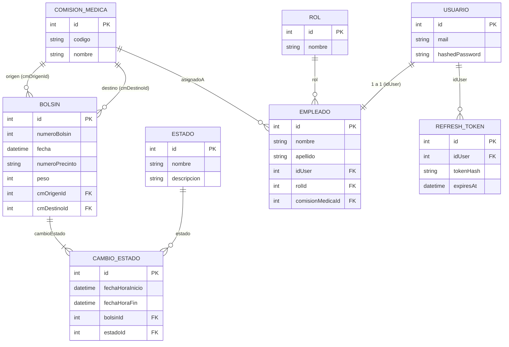

# 02 - Modelo de datos (CU 36)

Convencion: atributos y columnas en camelCase en todas las entidades (dominio y auth). Las funciones de `backend/utils/auth.py` mantienen el nombre del codigo de referencia.

Visibilidad: los atributos son privados (`-`) y se acceden con funciones get/set cuando hace falta. Los metodos de negocio son publicos (`+`). En SQLModel los campos se mapean como columnas; la privacidad es convencional (prefijo `_` o acceso por get/set), decision del equipo.

## 1. Entidades del CU 36

Remito queda fuera del modelo del CU 36: el CU filtra por CM origen y estado del bolsin, no necesita remitos. `Sesion` se reemplaza por `RefreshToken` (ver §5). La entidad de login se llama `Usuario` en el codigo.

### Bolsin (`backend/models/bolsin.py`)

| Atributo | Tipo Python | Clave |
|---|---|---|
| `id` | `int` | PK |
| `numeroBolsin` | `int` | unico, secuencial |
| `fecha` | `datetime` | |
| `numeroPrecinto` | `str \| None` | string para no perder ceros; nulo si esta creado |
| `peso` | `int` | gramos |
| `cmOrigenId` | `int` | FK a `ComisionMedica.id` |
| `cmDestinoId` | `int` | FK a `ComisionMedica.id` |

Relaciones:
- `origen: ComisionMedica` (N a 1), rol "origen", `foreign_keys=[cmOrigenId]`.
- `destino: ComisionMedica` (N a 1), rol "destino", `foreign_keys=[cmDestinoId]`.
- `cambiosEstado: list[CambioEstado]` (1 a 1..*), rol "cambioEstado", `back_populates="bolsin"`.

Metodos:

| Metodo | Visibilidad | Retorno | Notas |
|---|---|---|---|
| `esTuCMOrigen(codigoCM: str)` | publica | `bool` | `self.origen.getCodigo() == codigoCM` |
| `sosEnviado()` | publica | `bool` | Toma el cambio vigente (`sosActual()`) y le pide `sosEnviado()` |
| `getNumeroBolsin()` | publica | `int` | Devuelve `numeroBolsin` |
| `obtenerCMDestino()` | publica | `ComisionMedica` | Devuelve `destino` (E1) |

### CambioEstado (`backend/models/cambio_estado.py`)

| Atributo | Tipo Python | Clave |
|---|---|---|
| `id` | `int` | PK |
| `fechaHoraInicio` | `datetime` | |
| `fechaHoraFin` | `datetime \| None` | nulo = cambio vigente |
| `bolsinId` | `int` | FK a `Bolsin.id` |
| `estadoId` | `int` | FK a `Estado.id` |

Relaciones:
- `bolsin: Bolsin` (N a 1), `back_populates="cambiosEstado"`.
- `estado: Estado` (N a 1), rol "estado".

Metodos:

| Metodo | Visibilidad | Retorno | Notas |
|---|---|---|---|
| `sosActual()` | publica | `bool` | `fechaHoraFin is None` |
| `sosEnviado()` | publica | `bool` | `self.estado.esEnviado()` |
| `setFechaHoraFin(fecha: datetime)` | publica | `None` | Cierra el cambio vigente |

### Estado (`backend/models/estado.py`)

| Atributo | Tipo Python | Clave |
|---|---|---|
| `id` | `int` | PK |
| `nombre` | `str` | unico (Creado, Cerrado, Enviado, Recibido, De baja) |
| `descripcion` | `str` | |

Relaciones: ninguna hacia arriba. Es un catalogo cargado por seed.

Metodos:

| Metodo | Visibilidad | Retorno | Notas |
|---|---|---|---|
| `esEnviado()` | publica | `bool` | `self.nombre == "Enviado"` |

### ComisionMedica (`backend/models/comision_medica.py`)

| Atributo | Tipo Python | Clave |
|---|---|---|
| `id` | `int` | PK |
| `codigo` | `str` | unico |
| `nombre` | `str` | |

Metodos:

| Metodo | Visibilidad | Retorno |
|---|---|---|
| `getCodigo()` | publica | `str` |

### Rol (`backend/models/rol.py`)

| Atributo | Tipo Python | Clave |
|---|---|---|
| `id` | `int` | PK |
| `nombre` | `str` | unico |

Metodos:

| Metodo | Visibilidad | Retorno |
|---|---|---|
| `esGCM()` | publica | `bool` |
| `esEncargadoBolsines()` | publica | `bool` |

### Empleado (`backend/models/empleado.py`)

| Atributo | Tipo Python | Clave |
|---|---|---|
| `id` | `int` | PK |
| `nombre` | `str` | |
| `apellido` | `str` | |
| `idUser` | `int` | FK unica a `Usuario.id` (1 a 1) |
| `rolId` | `int` | FK a `Rol.id` |
| `comisionMedicaId` | `int` | FK a `ComisionMedica.id` |

Relaciones:
- `usuario: Usuario` (1 a 1), `uselist=False`, `back_populates="empleado"`.
- `rol: Rol` (N a 1), rol "rol".
- `comisionMedica: ComisionMedica` (N a 1), rol "asignadoA" (E1).

Metodos:

| Metodo | Visibilidad | Retorno | Notas |
|---|---|---|---|
| `esTuCM(codigoCM: str)` | publica | `bool` | `self.comisionMedica.getCodigo() == codigoCM` |
| `sosGCM()` | publica | `bool` | `self.rol.esGCM()` |
| `getCM()` | publica | `ComisionMedica` | |
| `getUsuario()` | publica | `Usuario` | |
| `obtenerGCMDeCM(codigoCM: str)` | publica | `Empleado` | Consulta simple del GCM de la CM destino (paso 12) | |

### Usuario (`backend/models/usuario.py`, entidad de login)

| Atributo | Tipo Python | Clave |
|---|---|---|
| `id` | `int` | PK |
| `mail` | `str` | unico, normalizado a minusculas |
| `hashedPassword` | `str` | hash (pwdlib/argon2) |

Relaciones: `empleado: Empleado | None` (1 a 1), `back_populates="usuario"`.

Metodos:

| Metodo | Visibilidad | Retorno |
|---|---|---|
| `verify_password(password: str)` | publica | `bool` |
| `getEmpleado()` | publica | `Empleado` |
| `getMail()` | publica | `str` |

### RefreshToken (`backend/models/refresh_token.py`, reemplaza a `Sesion` para auth)

| Atributo | Tipo Python | Clave |
|---|---|---|
| `id` | `int` | PK |
| `idUser` | `int` | FK a `Usuario.id` |
| `tokenHash` | `str` | |
| `expiresAt` | `datetime` | |

Relaciones: `usuario: Usuario` (N a 1), `back_populates` con `Usuario` (ver §2).

Ver §5: `Sesion` del diagrama no tiene tabla propia.

### UbicacionBolsin (`backend/models/ubicacion_bolsin.py`, value object)

| Atributo | Tipo Python |
|---|---|
| `numeroBolsin` | `int` |
| `latitud` | `float` |
| `longitud` | `float` |
| `fechaHoraUltimaActualizacion` | `datetime` |

No es tabla. `dataclass(frozen=True)` o Pydantic `BaseModel`, no SQLModel.

## 2. Mapeo a SQLModel

| Clase | `table=True` | Motivo |
|---|---|---|
| Bolsin | si | persistente |
| CambioEstado | si | persistente (historial) |
| Estado | si | catalogo |
| ComisionMedica | si | persistente |
| Rol | si | catalogo |
| Empleado | si | persistente |
| Usuario | si | auth |
| RefreshToken | si | auth |
| UbicacionBolsin | no | value object, viene del GPS |
| IAgregado, IIterador | no | ABC en `backend/models/iterator/` |
| IteradorBolsin | no | clase normal, recorre la lista |

Relaciones:
- **Origen y destino de Bolsin:** dos FK a `ComisionMedica`. SQLAlchemy necesita saber cual es cual: `sa_relationship_kwargs={"foreign_keys": "[Bolsin.cmOrigenId]"}` y lo mismo para `cmDestinoId`.
- **Bolsin -> CambioEstado:** `Relationship(back_populates="bolsin")` en ambos lados, con `cascade_delete` para que el historial se borre con el bolsin.
- **Empleado <-> Usuario (1 a 1):** `idUser` con `unique=True`, y `uselist=False` en el lado de `Usuario`.
- **Usuario -> RefreshToken (1 a N):** `idUser` FK sin unique.

**Carga en async:** las relaciones se cargan con `lazy="selectin"` o con `selectinload(...)` en la consulta. Sin eso, acceder a `bolsin.cambiosEstado` despues de cerrar la sesion falla con `MissingGreenlet`. Los metodos de negocio nunca disparan una carga lazy.

**`sosActual()`:** `CambioEstado.sosActual()` devuelve `fechaHoraFin is None`. El cambio vigente del bolsin es el que cumple esto.

**`sosEnviado()` y `esEnviado()`:** `Bolsin.sosEnviado()` busca el cambio vigente con `sosActual()` y le pide `sosEnviado()`. Ese metodo delega en `Estado.esEnviado()`. Se respeta la cadena del diagrama de secuencia: `Bolsin.sosEnviado` -> `CambioEstado.sosActual` -> `CambioEstado.sosEnviado` -> `Estado.esEnviado`.

El recorrido de `cambiosEstado` dentro de `Bolsin` es un bucle en el modelo, no en el gestor. AGENTS.md prohibe los bucles propios en el gestor, no en las entidades.

## 3. Diagrama ER



## 4. Reglas de negocio en el modelo

Los metodos viven en las entidades. Cada uno delega en colaboradores, como en el diagrama de secuencia de la Entrega 2:

```
Bolsin.esTuCMOrigen(codigoCM) -> bool
    -> self.origen.getCodigo() == codigoCM

Bolsin.sosEnviado() -> bool
    -> cambio = cambio vigente (cambio.sosActual() == True)
    -> cambio.sosEnviado()
        -> self.estado.esEnviado()

Bolsin.getNumeroBolsin() -> int
    -> self.numeroBolsin
```

El filtro del CU 36 (`esTuCMOrigen` y `sosEnviado`) no se implementa en el gestor. Lo ejecuta `IteradorBolsin.comprobarFiltro()`, que llama a los dos metodos de `Bolsin`.

Regla: una entidad no consulta la base ni llama a `integrations`. Si necesita datos de otra entidad, usa la relacion ya cargada.

## 5. Inconsistencias detectadas

| # | Inconsistencia | Fuente | Decision |
|---|---|---|---|
| 1 | `CambioEstado` (E2) vs `CambioEstadoBolsin` (E1, dominio, pedido de tarea). | E1, E2, dominio | Se usa `CambioEstado` (decision ya registrada, E2). |
| 2 | `IAgregado.crearIterador` devuelve `IIterator` en el texto de E2 y `IIterador` en el diagrama. | E2 | Se usa `IIterador` (nombre del diagrama y AGENTS.md §6). |
| 3 | `Usuario` y `Sesion` (E1) no existen en el dominio, que tiene `Empleado` y `Rol`. | E1 vs dominio | Se usa `Usuario` (login) y `RefreshToken` (sesion). `Sesion` no tiene tabla propia. |
| 4 | Origen y destino de Bolsin: E1 los tiene como asociacion a `ComisionMedica`; E2 no los modela. | E1, E2 | Se modelan como dos FK en `Bolsin`. |
| 5 | `numeroPrecinto` no aparece en E1 ni E2; si en dominio y ERS. | dominio, ERS | Se agrega como `str \| None`. |
| 6 | Estados de Bolsin: E1 usa "Creado, Cerrado, Enviado, Recibido, De baja"; ERS usa "Recibido en CM destino". | E1, ERS | Se usa el nombre de E1. |
| 7 | `numeroBolsin` aparece como atributo y como `getNumeroBolsin()`. | E2 | Atributo publico; el getter devuelve el mismo valor. |
| 8 | `Empleado` tiene `email` (dominio) y el login necesita `mail`. | dominio, auth | El correo es solo `Usuario.mail`. |
| 9 | `Remito` esta en E1 y en dominio, pero no en el CU 36. | E1, dominio | Fuera del modelo del CU 36. Se agrega cuando se implemente el CU 15. |
| 10 | `Estado` en E2 tiene `nombre` y `descripcion`; en dominio tiene ademas `ambito`. | E2, dominio | Se usa E2 (sin `ambito`). |
| 11 | Nombres de columnas: el codigo de referencia de auth usa snake_case (`id_user`, `token_hash`, `expires_at`); AGENTS.md §5 lo aceptaba como excepcion. | referencia auth, AGENTS.md | Se usa **camelCase en todas las columnas** (`idUser`, `tokenHash`, `expiresAt`, `hashedPassword`), decision del equipo. Las funciones de `utils/auth.py` mantienen el nombre de referencia. |

Las decisiones 1-11 se registran en `docs/99-decisiones-y-dudas.md`.
