# 04 - Vista estatica de la realizacion del CU 36

Consigna (Entrega 2, pag. 3): especificacion de tipos de datos, tipos de retorno, tipos de parametros y visibilidad de metodos (+ publico, - privado) de la estructura resultante de la aplicacion del patron Iterator.

Diagrama fuente: `docs/diagramas/clases-diseno.puml`.

## 1. Diagrama de clases de diseno

```plantuml
@startuml clases-diseno
skinparam linetype ortho
skinparam classAttributeIconSize 0
left to right direction

' Convenciones: - privado (se accede por get/set), + publico.
' new del diagrama de Entrega 2 se implementa como __init__ (init en Python).

interface IAgregado {
  + crearIterador(elementos: Bolsin[]): IIterador
}

interface IIterador {
  + primero(): void
  + siguiente(): void
  + haFinalizado(): bool
  + elementoActual(): Bolsin
  + comprobarFiltro(filtros: str[]): bool
}

class GestorBuscarBolsines {
  - seleccionBolsin: Bolsin
  - codigoBolsin: int[]
  + obtenerCodigoBolsinesEnviados(): int[]
  + crearIterador(elementos: Bolsin[]): IIterador
  + opcionSeguirBolsines(usuario: Usuario): void
  + tomarSeleccionBolsin(numeroBolsin: int): void
  + tomarConfirmacionEnvioCorreo(confirma: bool): void
  + cancelar(): void
  - enviarMailGCM(): bool
}

class IteradorBolsin {
  - lista: Bolsin[]
  - posicionActual: int
  - filtros: str[]
  + init(elementos: Bolsin[], filtros: str[])
  + primero(): void
  + siguiente(): void
  + haFinalizado(): bool
  + elementoActual(): Bolsin
  + comprobarFiltro(filtros: str[]): bool
  - posicionarEnValido(): void
}

class Bolsin {
  - numeroBolsin: int
  - fecha: datetime
  - numeroPrecinto: str
  - peso: int
  + esTuCMOrigen(codigoCM: str): bool
  + sosEnviado(): bool
  + getNumeroBolsin(): int
  + obtenerCMDestino(): ComisionMedica
}

class CambioEstado {
  - fechaHoraInicio: datetime
  - fechaHoraFin: datetime
  + sosActual(): bool
  + sosEnviado(): bool
  + setFechaHoraFin(fecha: datetime): void
}

class Estado {
  - nombre: str
  - descripcion: str
  + esEnviado(): bool
}

class ComisionMedica {
  - codigo: str
  - nombre: str
  + getCodigo(): str
}

class Empleado {
  - nombre: str
  - apellido: str
  + esTuCM(codigoCM: str): bool
  + sosGCM(): bool
  + getCM(): ComisionMedica
  + getUsuario(): Usuario
  + obtenerGCMDeCM(db: AsyncSession, codigoCM: str): Empleado
}

class Rol {
  - nombre: str
  + esGCM(): bool
  + esEncargadoBolsines(): bool
}

class Usuario {
  - mail: str
  - hashedPassword: str
  + verify_password(password: str): bool
  + getEmpleado(): Empleado
  + getMail(): str
}

class RefreshToken {
  - tokenHash: str
  - expiresAt: datetime
}

interface InterfazGPSTracker {
  + getBolsinLocation(numeroBolsin: int, codigoCM: str): UbicacionBolsin
}

interface InterfazGoogleMaps {
  + obtenerMapa(ubicaciones: UbicacionBolsin[]): MapaBolsines
}

interface InterfazCorreo {
  + enviarMail(destinatario: str, asunto: str, cuerpo: str): void
}

class UbicacionBolsin {
  - numeroBolsin: int
  - latitud: float
  - longitud: float
  - fechaHoraUltimaActualizacion: datetime
}

class MapaBolsines {
  - centro: Coordenada
  - zoom: int
  - marcadores: UbicacionBolsin[]
}

' Patron Iterator
IAgregado <|.. GestorBuscarBolsines : realiza
IIterador <|.. IteradorBolsin : realiza
GestorBuscarBolsines ..> IteradorBolsin : crea
GestorBuscarBolsines ..> Bolsin : usa
IteradorBolsin ..> Bolsin : comprueba filtro

' Dominio
Bolsin "1" *-- "1..*" CambioEstado : cambioEstado
CambioEstado "1..*" --> "1" Estado : estado
Bolsin "*" --> "1" ComisionMedica : origen
Bolsin "*" --> "1" ComisionMedica : destino
Empleado "*" --> "1" ComisionMedica : asignadoA
Empleado "*" --> "1" Rol : rol
Empleado "1" -- "1" Usuario : idUser
Usuario "1" -- "*" RefreshToken : idUser

' Integraciones
GestorBuscarBolsines ..> InterfazGPSTracker
GestorBuscarBolsines ..> InterfazGoogleMaps
GestorBuscarBolsines ..> InterfazCorreo
InterfazGPSTracker ..> UbicacionBolsin
InterfazGoogleMaps ..> MapaBolsines
MapaBolsines ..> UbicacionBolsin

@enduml
```

## 2. Especificacion por clase

Atributos privados (`-`): se acceden con funciones `get`/`set` cuando hace falta. Metodos publicos (`+`).

### 2.1 Patron Iterator

**IAgregado** (interfaz, `backend/models/iterator/i_agregado.py`)

| Visibilidad | Metodo | Parametros | Retorno |
|---|---|---|---|
| + | `crearIterador` | `elementos: Bolsin[]` | `IIterador` |

**IIterador** (interfaz, `backend/models/iterator/i_iterador.py`)

| Visibilidad | Metodo | Parametros | Retorno |
|---|---|---|---|
| + | `primero` | - | `void` |
| + | `siguiente` | - | `void` |
| + | `haFinalizado` | - | `bool` |
| + | `elementoActual` | - | `Bolsin` |
| + | `comprobarFiltro` | `filtros: str[]` | `bool` |

**GestorBuscarBolsines** (agregado concreto, `backend/services/gestor_buscar_bolsines.py`). Realiza `IAgregado`.

| Visibilidad | Atributo / metodo | Tipo | Retorno / parametros |
|---|---|---|---|
| - | `seleccionBolsin` | `Bolsin` | |
| - | `codigoBolsin` | `int[]` | |
| + | `obtenerCodigoBolsinesEnviados` | | `int[]` |
| + | `crearIterador` | `elementos: Bolsin[]` | `IIterador` |
| + | `opcionSeguirBolsines` | `usuario: Usuario` | `void` |
| + | `tomarSeleccionBolsin` | `numeroBolsin: int` | `void` |
| + | `tomarConfirmacionEnvioCorreo` | `confirma: bool` | `void` |
| + | `cancelar` | | `void` |
| - | `enviarMailGCM` | | `bool` |

**IteradorBolsin** (iterador concreto, `backend/models/iterator/iterador_bolsin.py`). Realiza `IIterador`.

| Visibilidad | Atributo / metodo | Tipo | Retorno / parametros |
|---|---|---|---|
| - | `lista` | `Bolsin[]` | |
| - | `posicionActual` | `int` | |
| - | `filtros` | `str[]` | |
| + | `init` | `elementos: Bolsin[], filtros: str[]` | constructor |
| + | `primero` | | `void` |
| + | `siguiente` | | `void` |
| + | `haFinalizado` | | `bool` |
| + | `elementoActual` | | `Bolsin` |
| + | `comprobarFiltro` | `filtros: str[]` | `bool` |
| - | `posicionarEnValido` | | `void` |

### 2.2 Dominio

**Bolsin** (`backend/models/bolsin.py`, SQLModel)

| Visibilidad | Atributo / metodo | Tipo | Retorno / parametros |
|---|---|---|---|
| - | `numeroBolsin` | `int` | |
| - | `fecha` | `datetime` | |
| - | `numeroPrecinto` | `str` | (nulo si esta creado) |
| - | `peso` | `int` | gramos |
| + | `esTuCMOrigen` | `codigoCM: str` | `bool` |
| + | `sosEnviado` | | `bool` |
| + | `getNumeroBolsin` | | `int` |
| + | `obtenerCMDestino` | | `ComisionMedica` |

**CambioEstado** (`backend/models/cambio_estado.py`, SQLModel)

| Visibilidad | Atributo / metodo | Tipo | Retorno / parametros |
|---|---|---|---|
| - | `fechaHoraInicio` | `datetime` | |
| - | `fechaHoraFin` | `datetime` | nulo = cambio vigente |
| + | `sosActual` | | `bool` |
| + | `sosEnviado` | | `bool` |
| + | `setFechaHoraFin` | `fecha: datetime` | `void` |

**Estado** (`backend/models/estado.py`, SQLModel)

| Visibilidad | Atributo / metodo | Tipo | Retorno / parametros |
|---|---|---|---|
| - | `nombre` | `str` | |
| - | `descripcion` | `str` | |
| + | `esEnviado` | | `bool` |

**ComisionMedica** (`backend/models/comision_medica.py`, SQLModel)

| Visibilidad | Atributo / metodo | Tipo | Retorno / parametros |
|---|---|---|---|
| - | `codigo` | `str` | |
| - | `nombre` | `str` | |
| + | `getCodigo` | | `str` |

**Empleado** (`backend/models/empleado.py`, SQLModel)

| Visibilidad | Atributo / metodo | Tipo | Retorno / parametros |
|---|---|---|---|
| - | `nombre` | `str` | |
| - | `apellido` | `str` | |
| + | `esTuCM` | `codigoCM: str` | `bool` |
| + | `sosGCM` | | `bool` |
| + | `getCM` | | `ComisionMedica` |
| + | `getUsuario` | | `Usuario` |
| + | `obtenerGCMDeCM` | `db: AsyncSession, codigoCM: str` | `Empleado \| None` |

**Rol** (`backend/models/rol.py`, SQLModel)

| Visibilidad | Atributo / metodo | Tipo | Retorno / parametros |
|---|---|---|---|
| - | `nombre` | `str` | |
| + | `esGCM` | | `bool` |
| + | `esEncargadoBolsines` | | `bool` |

**Usuario** (`backend/models/usuario.py`, SQLModel, entidad de login)

| Visibilidad | Atributo / metodo | Tipo | Retorno / parametros |
|---|---|---|---|
| - | `mail` | `str` | |
| - | `hashedPassword` | `str` | |
| + | `verify_password` | `password: str` | `bool` |
| + | `getEmpleado` | | `Empleado` |
| + | `getMail` | | `str` |

**RefreshToken** (`backend/models/refresh_token.py`, SQLModel, sesion de auth)

| Visibilidad | Atributo / metodo | Tipo | Retorno / parametros |
|---|---|---|---|
| - | `tokenHash` | `str` | |
| - | `expiresAt` | `datetime` | |

**UbicacionBolsin** (`backend/models/ubicacion_bolsin.py`, value object, no es tabla)

| Visibilidad | Atributo / metodo | Tipo | Retorno / parametros |
|---|---|---|---|
| - | `numeroBolsin` | `int` | |
| - | `latitud` | `float` | |
| - | `longitud` | `float` | |
| - | `fechaHoraUltimaActualizacion` | `datetime` | |

### 2.3 Integraciones (interfaces, `backend/integrations/`)

| Interfaz | Archivo | Metodo | Parametros | Retorno |
|---|---|---|---|---|
| `InterfazGPSTracker` | `gps_tracker/interfaz_gps_tracker.py` | + `getBolsinLocation` | `numeroBolsin: int, codigoCM: str` | `UbicacionBolsin` |
| `InterfazGoogleMaps` | `google_maps/interfaz_google_maps.py` | + `obtenerMapa` | `ubicaciones: UbicacionBolsin[]` | `MapaBolsines` |
| `InterfazCorreo` | `correo/interfaz_correo.py` | + `enviarMail` | `destinatario: str, asunto: str, cuerpo: str` | `void` |

`MapaBolsines` es el schema de salida (`backend/schemas/seguimiento.py`): `centro: Coordenada`, `zoom: int`, `marcadores: UbicacionBolsin[]`. La visualizacion la hace el frontend. `obtenerMapa` y los parametros de `enviarMail` son propuestas del equipo: la ERS no los define.

## 3. Decisiones de diseno

1. **`crearIterador` devuelve `IIterador`.** Corrige el `IIterator` del texto de la Entrega 2 (ver `docs/99-decisiones-y-dudas.md`).
2. **Visibilidad de atributos privada (`-`).** Se accede por `get`/`set` cuando hace falta. En SQLModel los campos se mapean como columnas; la privacidad es convencional (decision del equipo, ver `docs/02-modelo-datos.md`).
3. **`new` se implementa como `init`.** Es el constructor de Python. El diagrama de Entrega 2 usa `new`.
4. **Nombre de la clase de estado: `CambioEstado`** (Entrega 2), no `CambioEstadoBolsin`.
5. **Usuario de login: `Usuario`** (no `User`). Sus columnas van en camelCase. `RefreshToken` reemplaza a `Sesion`.
6. **Interfaces de integracion** (`InterfazGPSTracker`, `InterfazGoogleMaps`, `InterfazCorreo`) son clases de apoyo de analisis. El gestor depende de ellas, no de las implementaciones.
7. **Dependencias del gestor:** crea `IteradorBolsin`, usa `Bolsin` y depende de las interfaces de integracion. `IteradorBolsin` depende de `Bolsin` para `comprobarFiltro`. Esto respeta `docs/01-arquitectura.md` §5.
8. **Patron Iterator visible:** `IAgregado` lo realiza `GestorBuscarBolsines`, y `IIterador` lo realiza `IteradorBolsin` (ver `docs/03-patron-iterator.md`).
9. **Tipos de la Entrega 2 ajustados.** `IteradorBolsin.filtros` y `comprobarFiltro` usan `str[]`; `elementoActual()` devuelve `Bolsin`; `crearIterador` recibe `Bolsin[]`. La Entrega 2 usaba `Object[]` y `Object`. Registrado en `docs/99-decisiones-y-dudas.md`.
10. **`Bolsin`–`CambioEstado` como composicion (`*--`).** El historial de estados pertenece al bolsin y se elimina con el. La Entrega 2 lo muestra como asociacion simple.
11. **`obtenerMapa` devuelve `MapaBolsines`.** El backend arma centro, zoom y marcadores; el frontend dibuja con Google Maps.
