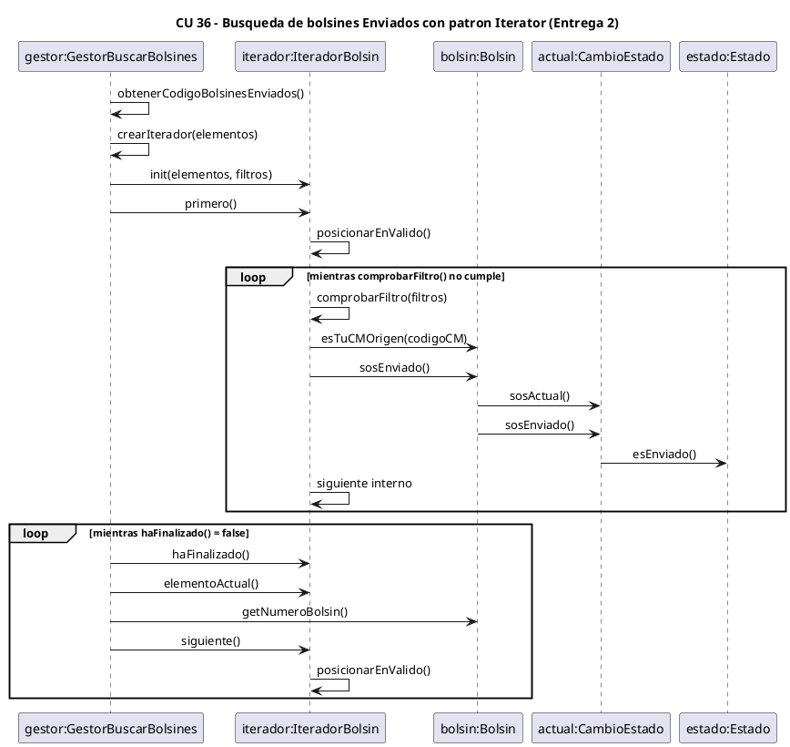

# 05 - Vista dinamica de la realizacion del CU 36

Consigna (Entrega 2, pag. 4): diagrama de secuencia de diseno donde se modela la parte del escenario que se redisena debido a la aplicacion del patron Iterator. El resto se mantiene igual que en analisis (Entrega 1).

Diagramas fuente:
- `docs/diagramas/secuencia-cu36-iterator.puml`: solo la parte rediseñada (Entrega 2).
- `docs/diagramas/secuencia-cu36-completo.puml`: flujo completo, pasos 1 a 14, con la porcion reemplazada marcada.

## 1. Diagrama de la parte rediseñada (Iterator)

## 2. Paso a paso

El gestor no recorre ni filtra la coleccion. Pide un iterador y consume sus elementos.

1. `gestor.obtenerCodigoBolsinesEnviados()`: metodo del agregado concreto. Devuelve los codigos de bolsin en estado Enviado de la CM del usuario logueado.
2. `gestor.crearIterador(elementos)`: `IAgregado.crearIterador`. Devuelve un `IIterador`.
3. `IteradorBolsin.init(elementos, filtros)`: el constructor recibe la coleccion de `Bolsin` y los filtros (`codigoCM` del usuario y estado Enviado).
4. `iterador.primero()`: se posiciona en el primer elemento que cumple `comprobarFiltro`.
5. `posicionarEnValido()`: recorre internamente la coleccion. Para cada `Bolsin` llama a `comprobarFiltro(filtros)`, que evalua:
   - `bolsin.esTuCMOrigen(codigoCM)`.
   - `bolsin.sosEnviado()`, que a su vez llama a `cambio.sosActual()`, luego `cambio.sosEnviado()`, y este llama a `estado.esEnviado()`.
6. Bucle del gestor, mientras `haFinalizado()` sea falso:
   - `elementoActual()`: devuelve un `Bolsin` valido.
   - `getNumeroBolsin()`: el gestor agrega el codigo a la lista de resultados.
   - `siguiente()`: avanza y vuelve a `posicionarEnValido()`.
7. El gestor devuelve la lista de codigos a la pantalla (paso 6 del CU, ver §3).

**Decision de diseno:** `primero()` y `siguiente()` avanzan hasta el siguiente elemento valido. Asi `elementoActual()` siempre devuelve un bolsin que cumple el filtro, y el gestor no necesita comprobar nada. Esto cambia la ubicacion de `comprobarFiltro` respecto de la Entrega 2, donde aparecia dentro del bucle del gestor (ver `docs/99-decisiones-y-dudas.md`).

## 3. Flujo completo (pasos 1 a 14)

Diagrama: `docs/diagramas/secuencia-cu36-completo.puml`. La porcion reemplazada respecto de la Entrega 1 aparece en un bloque `group` amarillo.

| Paso | Mensaje | Responsable |
|---|---|---|
| 1 | `opcionSeguirBolsines()` | EB -> PantallaBuscarBolsines |
| 2 | `habilitarPantalla()` | PantallaBuscarBolsines |
| 3 | `opcionSeguirBolsines(usuario)`, luego `getEmpleado()` | Pantalla -> Gestor -> Usuario |
| 4 | `getCM()` y `getCodigo()` | Gestor -> Empleado -> ComisionMedica |
| 5 | `mostrarCM(codigoCM)` | Gestor -> Pantalla |
| 6 | `obtenerCodigoBolsinesEnviados()` con el iterador | Gestor, IteradorBolsin, Bolsin, CambioEstado, Estado |
| 7 | `getBolsinLocation(numeroBolsin, codigoCM)` por cada bolsin | Gestor -> InterfazGPSTracker |
| 8 | `obtenerMapa(ubicaciones)` | Gestor -> InterfazGoogleMaps |
| 9 | `mostrarMapaBolsines(mapa)`, `pedirFormaSeleccionBolsin()` | Gestor -> Pantalla |
| 10 | `tomarSeleccionBolsin(numeroBolsin)` | EB -> Pantalla -> Gestor |
| 11 | `pedirConfirmacionEnvioCorreo()`, `tomarConfirmacionEnvioCorreo(confirma)` | Pantalla <-> EB, Pantalla -> Gestor |
| 12 | `enviarMailGCM()`: `obtenerCMDestino()`, `obtenerGCMDeCM(codigoCM)`, `sosGCM()`, `getUsuario()`, `getMail()` | Gestor -> Bolsin, Empleado, Usuario |
| 13 | `<<include>>` CU 31 `notificarUbicacion(...)` -> `enviarMail(...)` | Gestor -> Notificar ubicacion -> InterfazCorreo |
| 14 | `finCU()` | Gestor |

**Paso 12, decision:** el loop de la Entrega 1 (`esTuCM`, `sosGCM`, `esGCM` sobre empleados) se reemplaza por una consulta simple, `Empleado.obtenerGCMDeCM(codigoCM)`, que devuelve un unico empleado con rol Gerente de CM. El gestor no recorre empleados. Como consecuencia, `obtenerGCMDeCM` es un metodo nuevo que no esta en `docs/04-vista-estatica.md`; se agrega ahi al implementar.

**Paso 13:** el CU 31 se modela como `<<include>>` del CU 36, como en el diagrama de casos de uso de la ERS. Informa numero de bolsin, fecha y hora de ultima actualizacion, y coordenadas.

## 4. Tabla Entrega 1 vs Entrega 2

| Aspecto | Entrega 1 (analisis) | Entrega 2 (diseno) |
|---|---|---|
| Metodo del gestor | `obtenerBolsinesEnviados()` con loop propio | `obtenerCodigoBolsinesEnviados()` usando el iterador |
| Recorrido de bolsines | Loop en el gestor | `IteradorBolsin`: `primero`, `haFinalizado`, `elementoActual`, `siguiente` |
| Filtro | En el gestor: `esTuCMOrigen` y `sosEnviado` | En `comprobarFiltro()` del iterador, llamado desde `posicionarEnValido()` |
| Salida del recorrido | Lista de objetos `Bolsin` | Codigos de bolsin (`int[]`), obtenidos con `getNumeroBolsin()` |
| Construccion del recorrido | No aplica | `IAgregado.crearIterador` -> `IteradorBolsin.init(elementos, filtros)` |
| Usuario logueado | `Sesion.getUsuario()` | `user_dependency` (JWT) -> `Usuario` -> `Empleado` (sin `Sesion`) |
| Estado del bolsin | `CambioEstadoBolsin` | `CambioEstado` (decision registrada) |
| Enviar correo al GCM | Loop sobre empleados con `esTuCM`, `sosGCM`, `esGCM` | Consulta simple `obtenerGCMDeCM` y `sosGCM` |
| Constructor de iterador | No aplica | `init` (equivale al `new` del diagrama) |
| Reutilizacion | No | Mismo iterador con otros filtros (CU 28, ver `docs/03-patron-iterator.md`) |

## 5. Flujos alternativos y su efecto en la secuencia

| Alternativo | Afecta la secuencia | Tratamiento en el diagrama |
|---|---|---|
| **A1** No hay bolsines Enviados de la CM | Si. El iterador no produce elementos y `obtenerCodigoBolsinesEnviados` devuelve lista vacia. | `alt A1` despues del paso 6. El gestor informa "sin bolsines", termina el CU y no llama al GPS, al mapa ni al correo. |
| **A2** Precinto no encontrado | No afecta al gestor. El filtro por precinto se aplica en la pantalla sobre los datos ya cargados. | No aparece en la secuencia. Se documenta como filtro de la pantalla en el paso 9. |
| **A3** GPS no informa ubicacion | Si. Ocurre dentro del loop del paso 7. | `alt A3` dentro del loop. El bolsin queda registrado como "sin ubicacion" y el loop sigue con el resto. Si ninguno tiene ubicacion, la sesion queda abierta con `marcadores: []` y todos los bolsines en `sinUbicacion` (ver `docs/07-api-rest.md` §4). |
| **A4** EB cancela | Si. Puede ocurrir en pasos interactivos (9 a 11). | `alt A4` despues de la seleccion. Se modela como `DELETE /seguimiento-bolsines/{idCU}`. El gestor se descarta del registro en memoria y no se envia correo. |
| **A5** EB no confirma el correo | Si. Ocurre despues del paso 11. | `alt A5` en la confirmacion. No se llama a `enviarMailGCM`; el CU termina sin notificacion. |

## 6. Decisiones de diseno de esta vista

1. **`primero()` y `siguiente()` avanzan al proximo elemento valido.** `elementoActual()` siempre devuelve un bolsin que cumple el filtro. Corrige el diagrama de Entrega 2, donde `comprobarFiltro` estaba en el bucle del gestor.
2. **Paso 12 sin loop de empleados.** Se usa `Empleado.obtenerGCMDeCM(codigoCM)`. Cumple AGENTS.md §6: el gestor no recorre listas propias.
3. **`new` se dibuja como `init`.** Igual que en `docs/04-vista-estatica.md`.
4. **Sin `Sesion`.** El usuario llega por `user_dependency` (JWT).
5. **CU 31 como `<<include>>`.** Coincide con el diagrama de casos de uso de la ERS.
