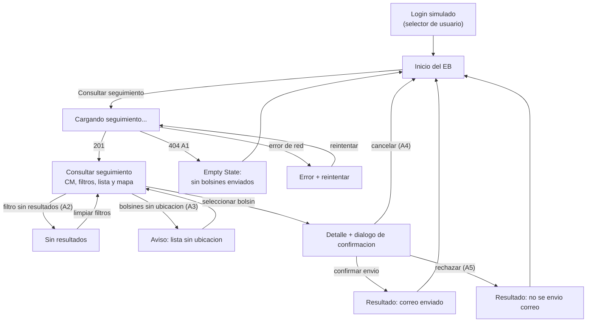

# 10 - Frontend (CU 36)

Interfaz web del CU 36 "Consultar seguimiento de bolsines". El frontend cumple el rol de **PantallaBuscarBolsines** del diseno: solo presenta datos, captura acciones del usuario y consume la API del backend. No contiene logica de negocio.

## Artefactos de UX

La consigna de UX del TP se trabajo en clase (mapa de empatia, customer journey y board). Esas imagenes no estan en el repositorio: el equipo las pega aca.


> Pendiente: copiar las imagenes en `docs/imagenes/` con esos nombres (o ajustar las rutas).

## 1. Stack

| Tecnologia | Eleccion | Justificacion |
|---|---|---|
| React 18 | Base de UI | Modelo de componentes y hooks, maduro y conocido por el equipo. |
| Vite | Build/dev server | Arranque y HMR rapidos; build simple. |
| TypeScript | Tipado | Tipa el contrato de la API y reduce errores en el mapeo de respuestas. |
| React Router | Ruteo | Rutas claras para Login, Inicio y Consultar seguimiento. |
| TanStack Query | Estado de servidor | Maneja carga, error, cache e invalidacion por `idCU` sin boilerplate. |
| Leaflet + react-leaflet | Mapa | Libre, sin API key, suficiente para mostrar marcadores sobre OpenStreetMap. |
| Tailwind CSS | Estilos | Utilitarios consistentes, responsive y faciles de auditar en accesibilidad. |

### Mapa y backend

El mapa se alimenta de los **marcadores** que devuelve la integracion de Maps del backend (`MapaBolsines`: `centro`, `zoom`, `marcadores`). El frontend solo dibuja esos datos con Leaflet/OpenStreetMap.

Cambiar a Google Maps JS implica reemplazar **solo el componente de mapa** (`MapaBolsines`); el contrato de datos (`centro`, `zoom`, `marcadores`) y el resto de la pantalla no cambian. Por eso hoy no se necesita `VITE_GOOGLE_MAPS_API_KEY`.

Variables del frontend:

- `VITE_API_URL=http://localhost:8020`.
- No requiere clave de mapas con Leaflet/OSM.

## 2. Mapeo del frontend al diseno

El frontend implementa la pantalla `PantallaBuscarBolsines`. Cada metodo del diagrama de secuencia se resuelve con un componente/hook y, cuando corresponde, un endpoint.

| Metodo de pantalla | Componente / hook | Endpoint |
|---|---|---|
| `opcionSeguirBolsines()` | `ConsultarSeguimientoPage` + `useSeguimiento()` | `POST /seguimiento-bolsines` |
| `habilitarPantalla()` | `PantallaShell` (layout, guard de sesion y skeleton inicial) | - (render) |
| `mostrarCM(codigoCM)` | `ComisionMedicaBadge` | - (usa `codigoCM` de la respuesta) |
| `mostrarMapaBolsines(mapa)` | `MapaBolsines` (Leaflet) | - (usa `mapa` de la respuesta) |
| `pedirFormaSeleccionBolsin()` | `ListaBolsines` + `FiltrosBolsines` | - (estado local; A2) |
| `tomarSeleccionBolsin(numeroBolsin)` | `useSeleccionBolsin()` | `POST /seguimiento-bolsines/{idCU}/seleccion` |
| `pedirConfirmacionEnvioCorreo()` | `DialogoConfirmacionCorreo` | - (estado local) |
| `tomarConfirmacionEnvioCorreo(confirma)` | `useConfirmarCorreo()` | `POST /seguimiento-bolsines/{idCU}/confirmacion-correo` |
| (A4) cancelar | `useCancelarCaso()` | `DELETE /seguimiento-bolsines/{idCU}` |

Notas:
- `habilitarPantalla`, `mostrarCM`, `mostrarMapaBolsines` y `pedirFormaSeleccionBolsin` son de presentacion/interaccion: no agregan endpoints.
- El `idCU` que devuelve el POST inicial se guarda en el estado del caso de uso y se usa en los endpoints siguientes.
- El login es **simulado** en el frontend: se elige un usuario de desarrollo y el backend resuelve `USUARIO_DEV`. El login JWT existe en `routes/auth.py`, pero las rutas del CU 36 usan el usuario de desarrollo.

## 3. Mapa de pantallas y flujo

- **Login (simulado) / estado del usuario:** selector de usuario de desarrollo; guarda el usuario actual en un contexto.
- **Inicio del EB:** acceso a "Consultar seguimiento".
- **Consultar seguimiento:** CM del usuario, filtros (precinto y CM destino), lista de bolsines (Master-Detail), mapa, detalle del bolsin seleccionado, dialogo de confirmacion de correo y resultado.



## 4. Estados de UI por flujo alternativo

| Caso | Estado de UI | Componente sugerido |
|---|---|---|
| **A1** Sin bolsines Enviados | Empty State con mensaje "No hay bolsines enviados para tu CM" y boton volver | `EmptyState` |
| **A2** Filtro sin resultados | Mensaje "Sin resultados para el filtro" + boton limpiar filtros | `FiltrosBolsines` + `EmptyState` |
| **A3** Bolsines sin ubicacion | Aviso persistente con lista de numeros sin ubicacion (campo `sinUbicacion`) | `AvisoSinUbicacion` |
| **A4** Cancelar | Dialogo de confirmacion; al confirmar vuelve a Inicio | `DialogoConfirmacion` |
| **A5** Rechazar correo | Feedback "No se envio el correo" y vuelve al listado | `Toast` |
| Carga | Skeleton de lista y spinner del mapa | `Skeleton` |
| Error de red | Mensaje de error con boton "Reintentar" | `ErrorState` |

El exito del correo muestra un Toast con el destinatario enmascarado (`g***@dominio`).

## 5. Patrones de diseno de GUI

| Patron | Que resuelve | Donde se ve |
|---|---|---|
| **Master-Detail** | Ver la lista y el detalle del bolsin sin perder contexto | Lista de bolsines + panel de detalle |
| **Filter/Search** | Acotar por precinto y CM destino (A2) | Barra de filtros sobre la lista |
| **Confirmation Dialog** | Evitar acciones destructivas/irreversibles (A4, A5) | Dialogo de confirmacion de correo y de cancelacion |
| **Empty State** | Explicar por que no hay datos y que hacer | A1 y A2 |
| **Toast/Feedback** | Confirmar el resultado de una accion | Correo enviado/no enviado, errores |
| **Breadcrumbs** | Ubicar al usuario en la jerarquia | Inicio > Consultar seguimiento |
| **Skeleton Loading** | Reducir la sensacion de espera | Carga inicial de la lista/mapa |

## 6. Lineamientos de UX

- **Accesibilidad basica:** contraste AA, foco visible, `label` en todos los inputs, navegacion por teclado y `aria-*` en dialogos y en el mapa.
- **Responsive:** una columna en movil (mapa arriba, lista y detalle abajo) y dos columnas en escritorio (lista/detalle + mapa).
- **Textos en espanol rioplatense neutro:** sin voseo marcado ni regionalismos; mensajes claros y directos.
- **Estados explicitos:** nunca dejar la pantalla "en blanco": siempre carga, vacio, error o contenido.

## 7. Arbol de archivos de `frontend/`

```
frontend/
  Dockerfile
  .dockerignore
  package.json
  vite.config.ts
  tsconfig.json
  index.html
  src/
    main.tsx
    App.tsx
    router.tsx
    api/
      cliente.ts                 # fetch a VITE_API_URL
      seguimiento.ts             # POST/seleccion/confirmacion/DELETE
      tipos.ts                   # Seguimiento, Mapa, Marcador, Bolsin, errores
    state/
      UsuarioContext.tsx         # login simulado / usuario actual
    pages/
      LoginPage.tsx
      InicioPage.tsx
      ConsultarSeguimientoPage.tsx
    components/
      PantallaShell.tsx          # layout, breadcrumbs, guard de sesion
      ComisionMedicaBadge.tsx
      MapaBolsines.tsx           # Leaflet + OpenStreetMap (reemplazable)
      ListaBolsines.tsx
      FiltrosBolsines.tsx
      DetalleBolsin.tsx
      DialogoConfirmacion.tsx
      DialogoConfirmacionCorreo.tsx
      AvisoSinUbicacion.tsx
      EmptyState.tsx
      ErrorState.tsx
      Skeleton.tsx
      Toast.tsx
    hooks/
      useSeguimiento.ts
      useSeleccionBolsin.ts
      useConfirmarCorreo.ts
      useCancelarCaso.ts
    lib/
      formato.ts                 # fechas y numeros
  public/
```

Nota: la implementacion actual del frontend es minima (`App.tsx`, `api.ts`, `MapView.tsx`). Este documento define la estructura objetivo del CU 36.
