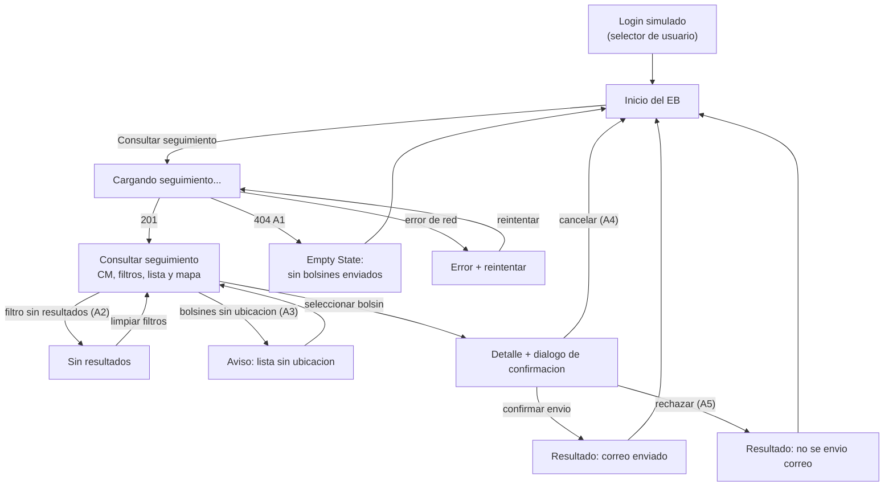

# 10 - Frontend (CU 36)

Interfaz web del CU 36 "Consultar seguimiento de bolsines". El frontend cumple el rol de **PantallaBuscarBolsines** del diseno: solo presenta datos, captura acciones del usuario y consume la API del backend. No contiene logica de negocio.

## Artefactos de UX

La consigna de UX del TP se trabajo en clase (mapa de empatia, customer journey y board). Esas imagenes no estan en el repositorio: el equipo las pega aca.


> Pendiente: copiar las imagenes en `docs/imagenes/` con esos nombres (o ajustar las rutas).

## 1. Stack

| Tecnologia | Eleccion | Justificacion |
|---|---|---|
| React 18 | Base de UI | Modelo de componentes y hooks, maduro y conocido por el equipo. |
| Vite | Build/dev server | Arranque y HMR rapidos; build simple. |
| TypeScript | Tipado | Tipa el contrato de la API y reduce errores en el mapeo de respuestas. |
| React Router | Ruteo | Rutas claras para Login, Inicio y Consultar seguimiento. |
| TanStack Query | Estado de servidor | Maneja carga, error, cache e invalidacion por `idCU` sin boilerplate. |
| Leaflet + react-leaflet | Mapa | Libre, sin API key, suficiente para mostrar marcadores sobre OpenStreetMap. |
| Tailwind CSS | Estilos | Utilitarios consistentes, responsive y faciles de auditar en accesibilidad. |

### Mapa y backend

El mapa se alimenta de los **marcadores** que devuelve la integracion de Maps del backend (`MapaBolsines`: `centro`, `zoom`, `marcadores`). El frontend solo dibuja esos datos con Leaflet/OpenStreetMap.

Cambiar a Google Maps JS implica reemplazar **solo el componente de mapa** (`MapaBolsines`); el contrato de datos (`centro`, `zoom`, `marcadores`) y el resto de la pantalla no cambian. Por eso hoy no se necesita `VITE_GOOGLE_MAPS_API_KEY`.

Variables del frontend:

- `VITE_API_URL`: vacio = mismo origen. El dev server de Vite proxya `/auth` y `/seguimiento-bolsines` a `PROXY_TARGET` (default `http://localhost:8020`; en Docker `http://backend:8020`). Una URL absoluta sigue siendo valida si se necesita.
- `server.allowedHosts` en `vite.config.ts` incluye el host de ngrok (`synodal-leora-unvolcanically.ngrok-free.dev`) para permitir el acceso remoto por un tunel al puerto `3020`.
- No requiere clave de mapas con Leaflet/OSM.

## 2. Mapeo del frontend al diseno

El frontend implementa la pantalla `PantallaBuscarBolsines`. Cada metodo del diagrama de secuencia se resuelve con un componente/hook y, cuando corresponde, un endpoint.

| Metodo de pantalla | Componente / hook | Endpoint |
|---|---|---|
| `opcionSeguirBolsines()` | `ConsultarSeguimientoPage` + `useSeguimiento()` | `POST /seguimiento-bolsines` |
| `habilitarPantalla()` | `PantallaShell` (layout, guard de sesion y skeleton inicial) | - (render) |
| `mostrarCM(codigoCM)` | `ComisionMedicaBadge` | - (usa `codigoCM` de la respuesta) |
| `mostrarMapaBolsines(mapa)` | `MapaBolsines` (Leaflet) | - (usa `mapa` de la respuesta) |
| `pedirFormaSeleccionBolsin()` | `ListaBolsines` + `FiltrosBolsines` | - (estado local; A2) |
| `tomarSeleccionBolsin(numeroBolsin)` | `useSeleccionBolsin()` | `POST /seguimiento-bolsines/{idCU}/seleccion` |
| `pedirConfirmacionEnvioCorreo()` | `DialogoConfirmacionCorreo` | - (estado local) |
| `tomarConfirmacionEnvioCorreo(confirma)` | `useConfirmarCorreo()` | `POST /seguimiento-bolsines/{idCU}/confirmacion-correo` |
| (A4) cancelar | `useCancelarCaso()` | `DELETE /seguimiento-bolsines/{idCU}` |

Notas:
- `habilitarPantalla`, `mostrarCM`, `mostrarMapaBolsines` y `pedirFormaSeleccionBolsin` son de presentacion/interaccion: no agregan endpoints.
- El `idCU` que devuelve el POST inicial se guarda en el estado del caso de uso y se usa en los endpoints siguientes.
- El login es **simulado** en el frontend: se elige un usuario de desarrollo y el backend resuelve `USUARIO_DEV`. El login JWT existe en `routes/auth.py`, pero las rutas del CU 36 usan el usuario de desarrollo.

## 3. Mapa de pantallas y flujo

- **Login (simulado) / estado del usuario:** selector de usuario de desarrollo; guarda el usuario actual en un contexto.
- **Inicio del EB:** acceso a "Consultar seguimiento".
- **Consultar seguimiento:** CM del usuario, filtros (precinto y CM destino), lista de bolsines (Master-Detail), mapa, detalle del bolsin seleccionado, dialogo de confirmacion de correo y resultado.



## 4. Estados de UI por flujo alternativo

| Caso | Estado de UI | Componente sugerido |
|---|---|---|
| **A1** Sin bolsines Enviados | Empty State con mensaje "No hay bolsines enviados para tu CM" y boton volver | `EmptyState` |
| **A2** Filtro sin resultados | Mensaje "Sin resultados para el filtro" + boton limpiar filtros | `FiltrosBolsines` + `EmptyState` |
| **A3** Bolsines sin ubicacion | Aviso persistente con lista de numeros sin ubicacion (campo `sinUbicacion`) | `AvisoSinUbicacion` |
| **A4** Cancelar | Dialogo de confirmacion; al confirmar vuelve a Inicio | `DialogoConfirmacion` |
| **A5** Rechazar correo | Feedback "No se envio el correo" y vuelve al listado | `Toast` |
| Carga | Skeleton de lista y spinner del mapa | `Skeleton` |
| Error de red | Mensaje de error con boton "Reintentar" | `ErrorState` |

El exito del correo muestra el Toast "Correo enviado." y el panel indica "Correo enviado el `<fecha>`".

## 5. Patrones de diseno de GUI

| Patron | Que resuelve | Donde se ve |
|---|---|---|
| **Master-Detail** | Ver la lista y el detalle del bolsin sin perder contexto | Lista de bolsines + panel de detalle |
| **Filter/Search** | Acotar por precinto y CM destino (A2) | Barra de filtros sobre la lista |
| **Confirmation Dialog** | Evitar acciones destructivas/irreversibles (A4, A5) | Dialogo de confirmacion de correo y de cancelacion |
| **Empty State** | Explicar por que no hay datos y que hacer | A1 y A2 |
| **Toast/Feedback** | Confirmar el resultado de una accion | Correo enviado/no enviado, errores |
| **Breadcrumbs** | Ubicar al usuario en la jerarquia | Inicio > Consultar seguimiento |
| **Skeleton Loading** | Reducir la sensacion de espera | Carga inicial de la lista/mapa |
| **Tabs (responsive)** | Alternar lista y mapa en pantallas angostas | Pestanas Lista/Mapa en movil |

## 6. Lineamientos de UX

- **Accesibilidad basica:** contraste AA (textos chicos en `slate-600` o mas oscuro), **foco visible global** (`:focus-visible` con outline), `label` en todos los inputs, navegacion por teclado y `aria-*` en dialogos (con *focus trap*) y en el mapa (region con `aria-label`; la lista es la alternativa por teclado).
- **Responsive:** en movil se muestran **pestanas Lista / Mapa** (una vista por vez; el detalle del bolsin aparece debajo del mapa) y en escritorio dos columnas (lista/detalle + mapa).
- **Textos en espanol rioplatense neutro:** sin voseo marcado ni regionalismos; mensajes claros y directos. Los errores tecnicos se traducen a mensajes de usuario (`lib/errores.ts`).
- **Estados explicitos:** nunca dejar la pantalla "en blanco": siempre carga, vacio, error o contenido.

## 7. Arbol de archivos de `frontend/`

```
frontend/
  .env.example
  Dockerfile
  .dockerignore
  package.json
  package-lock.json
  vite.config.ts
  tsconfig.json
  tailwind.config.js
  postcss.config.js
  index.html
  src/
    main.tsx                    # QueryClientProvider + RouterProvider
    router.tsx                  # rutas / y /seguimiento
    index.css                   # Tailwind
    vite-env.d.ts
    api/
      client.ts                 # fetch a VITE_API_URL + ApiError tipada
      auth.ts                   # GET /auth/me
      seguimiento.ts            # iniciar/seleccionar/confirmar/cancelar
      client.test.ts
      seguimiento.test.ts
    components/
      AppShell.tsx              # layout base: header + contenido
      Header.tsx                # nombre del sistema + usuario (/auth/me)
      EstadoCarga.tsx
      EstadoError.tsx
      EstadoVacio.tsx           # Empty State (A1/A2)
      SkeletonLista.tsx         # carga
      MapaBolsines.tsx          # Leaflet/OSM + fix de iconos para Vite
      Breadcrumbs.tsx           # Inicio > Seguimiento de bolsines
      DialogoConfirmacion.tsx   # confirmar / no enviar / cancelar + focus trap
      Toast.tsx                 # feedback de exito/error (aria-live)
      Tabs.tsx                  # pestanas Lista / Mapa (movil)
      Header.test.tsx
      EstadoVacio.test.tsx
      EstadoError.test.tsx
      DialogoConfirmacion.test.tsx
      Tabs.test.tsx
    features/
      seguimiento/
        index.ts
        ListaBolsines.tsx       # lista accesible (botones, aria-pressed)
        FiltrosBolsines.tsx     # precinto + CM destino
        AvisoSinUbicacion.tsx   # banner A3
        DetalleBolsin.tsx       # panel del bolsin (paso 7) + notificar
        ListaBolsines.test.tsx
        FiltrosBolsines.test.tsx
    hooks/
      useUsuarioActual.ts       # useQuery('/auth/me')
      useIniciarSeguimiento.ts  # useMutation POST /seguimiento-bolsines
      useSeleccionarBolsin.ts   # useMutation POST .../seleccion
      useConfirmarCorreo.ts     # useMutation POST .../confirmacion-correo
      useCancelarSeguimiento.ts # useMutation DELETE .../{idCU}
    pages/
      HomePage.tsx
      SeguimientoPage.tsx       # Master-Detail, filtros, mapa, pasos 7-11, A1-A5
      SeguimientoPage.test.tsx
    types/
      auth.ts                   # TokenResponse, UsuarioActualOut, EmpleadoMeOut
      seguimiento.ts            # nombres iguales a los schemas del backend
                                # (SeguimientoCreadoResponse, MapaBolsinesOut,
                                #  MarcadorOut, SeleccionBolsinRequest/Response,
                                #  ConfirmacionCorreoRequest/Response, ErrorResponse)
    lib/
      formato.ts
      errores.ts                # mensajes de error para el usuario
      errores.test.ts
    test/
      setup.ts                  # jest-dom
```

El layout base (`AppShell` + `Header`) muestra el nombre del sistema y los datos del usuario logueado consultando `GET /auth/me` con TanStack Query (con estado de carga y error).

## 8. Evidencia de UX

Placeholders para las imagenes del equipo (copiar en `docs/imagenes/` con esos nombres o ajustar las rutas):


| Pantalla | Patron | Decision de diseno |
|---|---|---|
| Inicio | Breadcrumbs / navegacion | Encabezado simple y acceso directo a "Consultar seguimiento". |
| Seguimiento (escritorio) | Master-Detail | Lista a la izquierda; mapa y detalle a la derecha; seleccion sincronizada. |
| Seguimiento (movil) | Tabs (responsive) | Pestanas Lista/Mapa, una vista por vez, conservando la seleccion. |
| Filtros | Filter/Search | Precinto (texto) y CM destino (select), aplicados a la lista y a los marcadores (A2). |
| Carga | Skeleton Loading | Esqueleto de la lista y estado accesible "Cargando seguimiento". |
| A1 / A2 | Empty State | Mensaje claro y accion para limpiar filtros o volver. |
| A3 | Aviso / Feedback | Banner con la lista de bolsines sin ubicacion. |
| Notificar ubicacion | Confirmation Dialog | Confirmar / No enviar / Cancelar, con foco atrapado y Esc. |
| Resultado del envio | Toast / Feedback | "Correo enviado." o mensaje de error, y fecha en el panel. |
| Cancelar consulta | Confirmation Dialog | Confirmacion y vuelta a Inicio. |
| Lista de bolsines | Teclado | Cada fila es un boton (`aria-pressed`); Tab y Enter/Espacio. |
